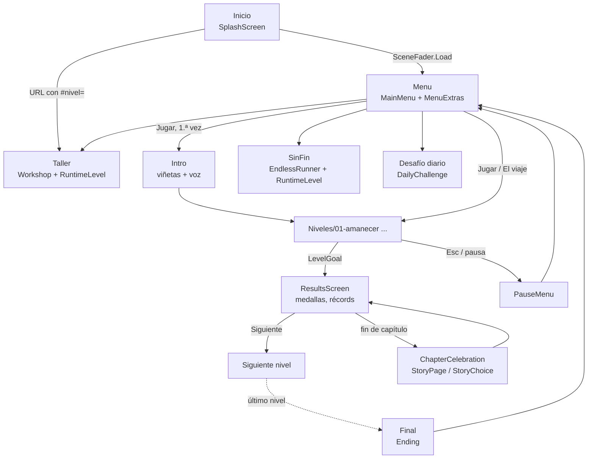
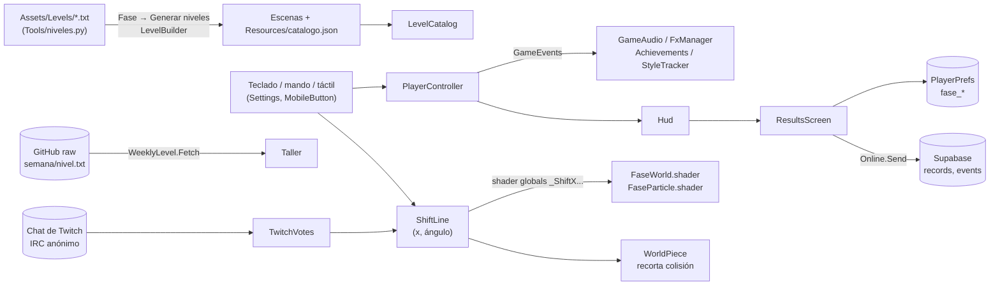

# Arquitectura de FASE

Cómo está montado el juego por dentro. Todo lo de aquí sale de leer `Assets/Scripts/` (namespace `Fase`), `Assets/Editor/` y `Tools/`.

Ver también: [BUILDING.md](BUILDING.md) (compilar) · [ROADMAP.md](ROADMAP.md) (qué falta) · [CONTINUAR_DESARROLLO.md](CONTINUAR_DESARROLLO.md) (guía para el autor) · [docs/DISENO.md](docs/DISENO.md) (diseño).

## Resumen

- Unity 6000.6.7f1, URP 17.6.0, Input System 1.20.1, uGUI. Plataformas: web (WebGL), Windows y Android.
- Es un puzle-plataformas 2.5D: la lógica es **2D** (física 2D, `BoxCollider2D`) y el arte es 3D visto de lado.
- **Los niveles no se dibujan en Unity**: se escriben como texto y un generador del editor crea las escenas.
- **La interfaz se construye por código** (`UiKit`), no con prefabs.
- Los sistemas hablan entre sí por **eventos estáticos** (`GameEvents`) y por **singletons de escena** (`ShiftLine.Instance`, `Hud.Instance`).
- Se guarda todo en `PlayerPrefs` (en la web, el navegador). Lo único en línea es Supabase (récords, analítica), el nivel de la semana (GitHub) y el chat de Twitch.

## Flujo de escenas

Todas las transiciones pasan por `SceneFader.Load(escena)`. Las escenas son: `Inicio`, `Menu`, `Intro`, `Final`, `Taller`, `SinFin` y una escena por nivel en `Assets/Scenes/Niveles` (historia, secretos, extra y 14 desafíos diarios). La lista de escenas de compilación la rehace **Fase → Generar niveles** (`LevelBuilder.BuildAll`).

## Flujo de datos

## Sistemas principales

### Línea día/noche (el corazón del juego)

- `ShiftLine` es la línea que parte el mundo: a un lado es de día y al otro de noche. Se mueve con Shift izq./der. o Q/E, o arrastrándola con el ratón o el dedo. Tiene posición (`x`), ángulo (vertical, inclinada o tumbada), una segunda línea opcional (`x2`) y funciones estáticas como `ShiftLine.IsDay(punto)`.
- Cada fotograma publica su estado como variables globales de shader (`_ShiftX`, `_ShiftX2`, `_LineCount`, `_DayOnLeft`, `_LineP`, `_LineN`, `_Bubble`...). Los shaders `FaseWorld` y `FaseParticle` **recortan el dibujo** de cada pieza según su mundo.
- `WorldPiece` es la parte de física: recorta el `BoxCollider2D` de lo que solo existe en un mundo (puente de día, hielo de noche) cada paso de física para que solo sea sólido el trozo visible.
- Alrededor de la línea hay muchas piezas que reaccionan: `LineVisual` (dibujo), `LineJuice` (chispas y estelas), `LineReactor` (plantas que se doblan, charcos agua/hielo), `PieceHighlight` (contorno dorado en lo que va a cambiar), `PieceIcons` (sol/luna para quien no distingue colores), `SunsetBand`, `LineHint`/`LineAdvisor` (ayuda opcional que enseña dónde ponerla), `MusicLayers` (música de día y de noche sincronizadas, el volumen de cada una depende de cuánta pantalla ocupa su mundo) y `LightMood` (la luz principal cambia de sol a luna).
- Variantes de la línea, activadas por cabeceras del nivel: `CurveLine` (arco), `LineWeight` (péndulo), `LineChase` (la noche avanza sola), `LineEnergy`, `LineDoor`.

### Jugador (Lumi)

- `PlayerController`: plataformas con física 2D (tiempo de coyote, salto guardado, doble salto y planeo como habilidades). Dispara `GameEvents.Jumped/Landed/Step/Died`.
- Alrededor: `CameraFollow`, `LumiStyle` (aspecto), `Scarf` (bufanda con física Verlet), `LumiGaze` (mira lo importante), `LumiReactions`, `LumiSleep`, `LumiBubble` (bocadillos), `BlobShadow`, `Footprints`, `LanternPower` (burbuja de noche del farol), `Companion` (Chispa).
- Otros modos de control: `OneTouchMode` (un toque), `MobileControls`/`MobileButton`/`TouchEditor` (táctil movible), `RaceMode` (dos jugadores en la misma pantalla), `MirrorMode`.
- Enemigos y peligros: `Monster` (Sombras), `Boss`/`BossWave`, `Hazard`, `LineChaser`, `Tide`, `Wind`, `AirCurrent`.

### Niveles generados desde texto

1. Cada nivel es un `.txt` en `Assets/Levels` (cabecera con `nombre`, `pista`, `linea`, `capitulo`... y un mapa con una letra por casilla). El formato está en `Assets/Levels/LEEME.md`.
2. `Tools/niveles.py` escribe esos `.txt` (también los secretos, los extra y los 14 `Diarios/`). `Tools/comprobar_niveles.py` comprueba que todos se pueden terminar y lo ejecuta GitHub en cada cambio ([`.github/workflows/niveles.yml`](.github/workflows/niveles.yml)).
3. En Unity, **Fase → Generar niveles** (`LevelBuilder`, partial class repartida en `Assets/Editor/LevelBuilder*.cs`) lee cada texto y crea la escena: arte, colisiones, sonido, música, posprocesado, partículas, interfaz y controles táctiles; también el menú, el final, el Taller y Sin fin. Escribe `Resources/catalogo.json`.
4. En ejecución, `LevelCatalog` lee ese catálogo (escena, nombre, capítulo, fragmentos y tiempos de medalla de cada nivel).
5. `RuntimeLevel` monta un mapa de texto **mientras se juega**, con las piezas de `Resources/Piezas`: lo usan el Taller y Sin fin. `LevelCode` comprime un mapa a un código `FASE-...` (base64 seguro para URL).

### HUD, resultados y medallas

- `Hud` (singleton por escena): nombre del nivel, número, lunas, cronómetro, pista, farol; cuenta caídas y agarres. Restaura el último punto de control (`SaveGuard`).
- `LevelGoal` (la meta) guarda el progreso (`Progress.Complete`), lanza `GameEvents.GoalReached` y abre `ResultsScreen`.
- `ResultsScreen`: tiempo, fragmentos, las cuatro medallas, desafíos del nivel (sin caer, toda la luna, pocas veces la línea), récord, tabla de récords en línea y botones Siguiente, Repetir y Compartir. Al acabar un capítulo muestra antes `ChapterCelebration`, `StoryPage` y, tras el capítulo II, `StoryChoice`.
- `Medals`: Bronce, Plata, Oro y Luna (secreta). Los tiempos vienen del catálogo; en modo asistido, en el desafío diario y con mutadores no se da medalla. También: `StyleMedals`/`StyleTracker` (medallas de estilo), `Stats` (estadísticas), `Achievements` (logros que escuchan `GameEvents`), `Diary`, `Feathers`.

### Guardado

- Todo va a `PlayerPrefs` con claves que empiezan por `fase_`. `Progress` guarda el nivel desbloqueado, los fragmentos y los volúmenes; `SaveGuard` fuerza `PlayerPrefs.Save()` cada 10 s, al perder el foco, al pausar y al cerrar (en la web si no, el navegador no lo escribe), y recuerda el último punto de control por nivel.
- Familias de claves (no son todas): `fase_desbloqueado`, `fase_luna_N`, `fase_tiempo_N`, `fase_medalla_N`, `fase_logro_*`, `fase_cuenta_*` (estadísticas), `fase_idioma`, `fase_musica`, `fase_efectos`, `fase_brillo`, `fase_tecla_*`, `fase_asistido`, `fase_contraste`, `fase_relajado`, `fase_nombre`, `fase_taller` (el mapa del Taller), `fase_twitch`, `fase_analitica`, `fase_seguir_N` (punto de control), `fase_fantasma_*`, `fase_compra_*`, `fase_decision`, `fase_final`, `fase_racha`.
- Borrar el progreso: `Progress.ResetAll()` (borra **todo** `PlayerPrefs`).

### Transiciones

`SceneFader` (singleton que sobrevive entre escenas): una cortina de noche entra barriendo con la línea brillante en el borde, carga la escena de forma asíncrona y sale por la derecha; muestra consejos mientras carga. Se usa así: `SceneFader.Load("Menu")`.

### Localización

- `Loc` (clase parcial) guarda el idioma en `fase_idioma`: 0 español, 1 inglés, 2 portugués, 3 francés; la primera vez se elige el del sistema.
- `Loc.Pick(es, en)` devuelve español o inglés; para portugués y francés busca el **texto en español** en las tablas de `LocTranslations` y `LocTranslations2`. Si no está, cae en inglés. `Loc.Pick(es, en, pt, fr)` es para textos con números, que no se pueden buscar en la tabla.
- En el editor, lo que sale en inglés por falta de traducción se apunta en `Logs/sin-traducir.txt`; se rellena con `Tools/anadir_traducciones.py`. `LocText` traduce un texto de la interfaz al cambiar de idioma.
- Otros: `TextScaler` (tamaño de texto de accesibilidad), `AspectFit` (la interfaz está hecha a 1920×1080 y escala por la anchura en pantallas más estrechas que 16:9).

### Interfaz por código (`UiKit`)

`UiKit` crea lienzos, cajas redondeadas, textos (fuente Fredoka Fase de `Resources`) y botones con el mismo estilo (paneles morados, oro). Todo lo que se monta mientras se juega (resultados, logros, armario, avisos, Twitch, tienda) lo usa; `UiHover` hace que los botones suenen y se inclinen hacia el ratón. `UiRunner` es un `MonoBehaviour` vacío para lanzar corrutinas fuera de las escenas.

### Menú

`MainMenu` (Jugar/Continuar, El viaje, Opciones) más tres archivos parciales `MenuExtras*.cs` que montan al arrancar la barra de iconos, logros, armario, accesibilidad, modo espejo, **Extras** (estadísticas, banda sonora, galería, álbum, mapa de capítulos, retos de la semana, **Nivel de la semana**, **Twitch**) y **Retos / Con amigos / Habilidades**. Apoyo: `MenuMood` (hora real), `MenuTalk`, `MenuWalker`, `JourneyWalker` (Lumi camina por el mapa).

### En línea (`Online.cs`)

- `Online`: peticiones REST a **Supabase** (`UnityWebRequest`) con la clave **pública anon**. Si `Url` o `Key` están vacíos, todo lo en línea se apaga.
- `OnlineRecords.SubmitAndFetch`: sube el tiempo (si el jugador tiene nombre, máx. 12 letras) a `records` y trae el top 10 con la función `top_records`.
- `Analytics`: eventos anónimos `start`, `death`, `finish`, `quit` (nivel, posición x, segundos; sin nombre ni identificador) a `events`. Se apaga en Opciones → Controles (`fase_analitica`). Se envían juntos al terminar o salir del nivel.
- Las tablas, las reglas (RLS) y la función están en `Tools/supabase.sql`: el cliente solo puede leer récords e insertar filas; no puede borrar ni leer `events`.

### Nivel de la semana

`WeeklyLevel` descarga `semana/nivel.txt` desde `raw.githubusercontent.com` (rama `fase`): línea 1 `nombre | name`, línea 2 autor, línea 3 código `FASE-...`. Valida con `LevelCode.Decode`. `Play()` abre el Taller con ese código (`LinkOpener.PendingCode` y `PlayNow`). Los jugadores envían el suyo con la plantilla de issue `nivel.yml`.

### Twitch

- `TwitchVotes` entra al chat de un canal como invitado anónimo (`justinfan…`, sin OAuth, solo lectura) por WebSocket en `wss://irc-ws.chat.twitch.tv`. Cuenta un voto por persona y ronda (3 s) de `!izquierda`/`!derecha`, `!left`/`!right` o `<`/`>`, y desliza la línea hacia el lado ganador.
- En **WebGL** usa `Assets/Plugins/WebGL/Twitch.jslib` (cuatro funciones `FaseTwitch*`, un `WebSocket` del navegador y una cola de líneas). En **escritorio/editor** usa `ClientWebSocket` en un hilo. El canal se guarda en `fase_twitch`.

### Taller y enlaces

`Workshop` es un editor de niveles (cuadrícula con las mismas letras, paleta con iconos, prueba al momento, código `FASE-...`; guarda en `fase_taller`). `LinkOpener` lee `#nivel=FASE-...` (o `?nivel=`) de la URL y abre el Taller con él: solo funciona donde el juego tiene dirección propia, no dentro del marco de itch.

## Tabla archivo → responsabilidad

| Archivo | Responsabilidad |
|---|---|
| `ShiftLine.cs` | La línea: posición, ángulo, entrada, variables globales de shader |
| `WorldPiece.cs` | Colisión recortada a su mundo (día/noche) |
| `PlayerController.cs` | Movimiento, salto y muerte de Lumi |
| `CameraFollow.cs` | Cámara lateral, temblor y acercamiento a la meta |
| `GameEvents.cs` | Bus de eventos estáticos (saltar, morir, meta, coger luna...) |
| `Hud.cs` | HUD del nivel, contadores, cronómetro, último punto de control |
| `LevelGoal.cs` | Meta: guarda progreso y abre resultados |
| `ResultsScreen.cs` | Pantalla de resultados, medallas, récords en línea, compartir |
| `Medals.cs` | Medallas de tiempo y su guardado |
| `LevelCatalog.cs` | Lista de niveles (lee `catalogo.json`) |
| `RuntimeLevel.cs` | Monta niveles de texto en ejecución (Taller, Sin fin) |
| `LevelCode.cs` | Códigos `FASE-...` para compartir niveles |
| `Workshop.cs` | Editor de niveles |
| `EndlessRunner.cs` | Modo sin fin adaptativo |
| `Progress.cs` | Progreso, fragmentos, tiempos y volúmenes |
| `SaveGuard.cs` | Guardado periódico y punto de control |
| `SceneFader.cs` | Transición entre escenas |
| `Loc.cs` · `LocTranslations*.cs` | Idiomas (es, en, pt, fr) |
| `UiKit.cs` | Piezas de interfaz creadas por código |
| `MainMenu.cs` · `MenuExtras*.cs` | Menú principal y Extras |
| `Online.cs` | Supabase: récords en línea y analítica |
| `WeeklyLevel.cs` | Nivel de la semana desde GitHub |
| `TwitchVotes.cs` | Votación del chat de Twitch |
| `LinkOpener.cs` | Abrir el Taller desde la URL |
| `MusicLayers.cs` · `GameAudio.cs` | Música en capas y efectos de sonido |
| `Achievements.cs` · `Stats.cs` | Logros y estadísticas |
| `Settings.cs` | Accesibilidad, teclas configurables, vibración |
| `Boss.cs` | La Gran Sombra (jefe final) |
| `Wardrobe.cs` · `Shop.cs` | Armario y tienda de cosméticos |
| `Assets/Editor/LevelBuilder*.cs` | Generador de escenas desde los `.txt` |
| `Assets/Editor/WebBuild.cs` | Exportar web, Windows y Android |
| `Assets/Editor/LevelPlaytest.cs` · `Scripts/PlayBot.cs` | Bot que juega los niveles (a medias) |
| `Assets/Shaders/FaseWorld.shader` | Recorte día/noche del dibujo de cada pieza |

## Herramientas fuera de Unity

`Tools/` son scripts de Python (niveles, música, efectos, fuente, traducciones, tráiler) y `Tools/prueba_web` (prueba de humo de la web con Playwright). Descripción de cada uno en [`Tools/README.md`](Tools/README.md).
