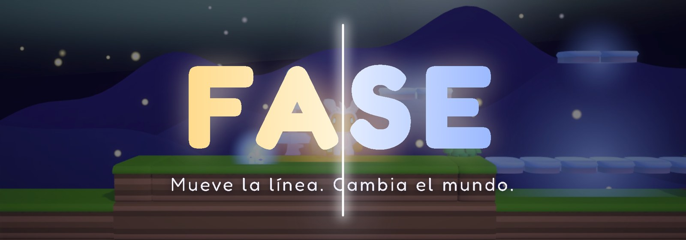
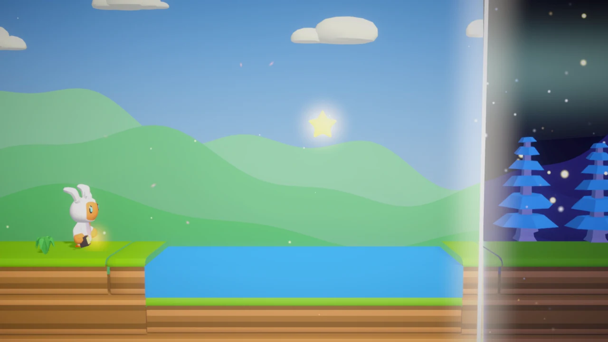
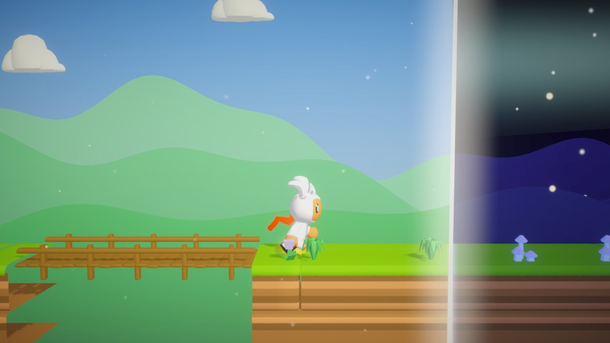
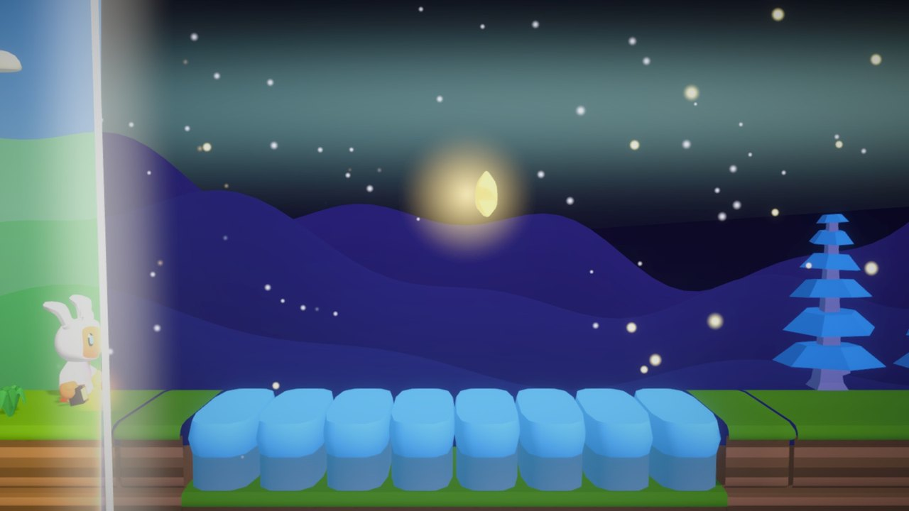
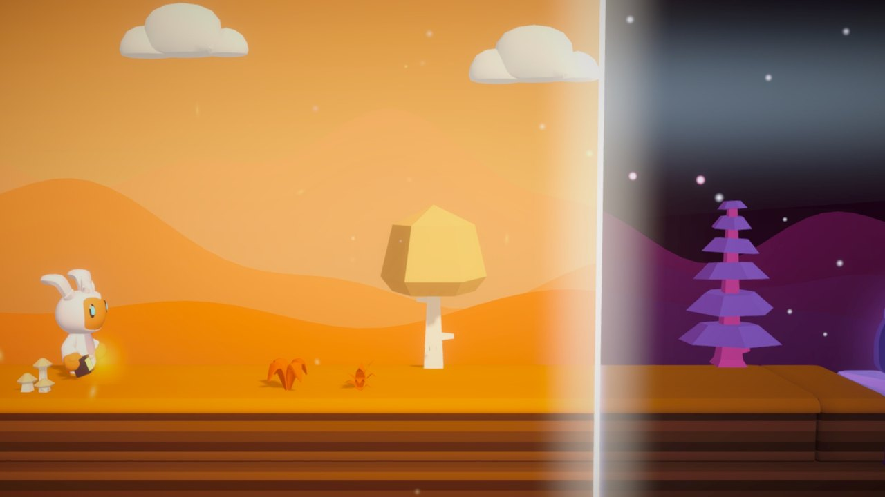
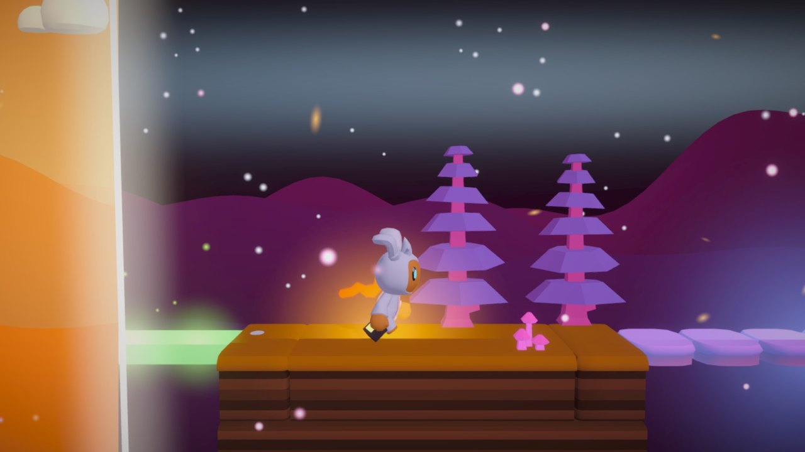
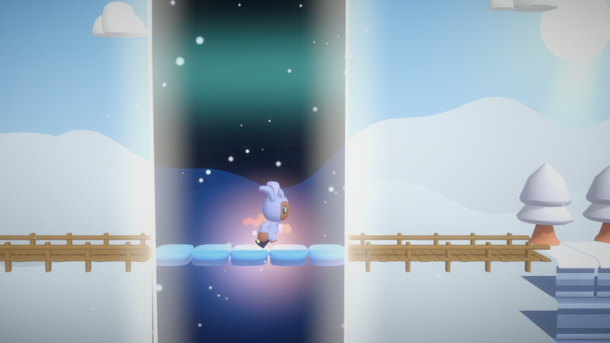
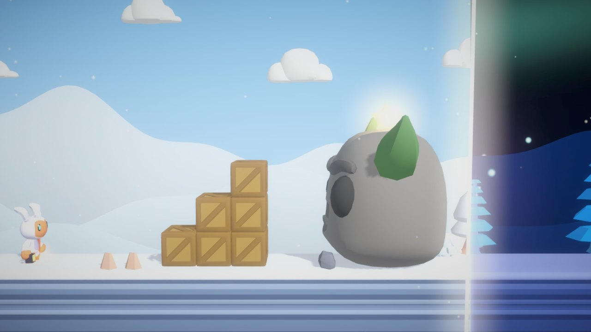

<div align="center">



**Mueve la línea. Cambia el mundo.** · *Shift the line. Change the world.*

[](https://0scar07.itch.io/game-off-2026)
[](https://itch.io/jam/game-off-2026)
[](https://unity.com)
[](https://github.com/0scar07/game-off-2026/actions/workflows/niveles.yml)
[](https://github.com/0scar07/game-off-2026/actions/workflows/itch-web.yml)
[](LICENSE)
[](https://github.com/0scar07/game-off-2026/releases)
[](https://github.com/0scar07/game-off-2026/releases)

Plataformas y puzles 2.5D para el **GitHub Game Off 2026** (tema **SHIFT**).<br>
Navegador, Windows y Android · Español, English, Português, Français.



<sub>[GIF en máxima calidad](docs/fase-maxima-calidad.gif) · [GIF ligero](docs/fase.gif)</sub>

[Jugar](#jugar) · [En 30 segundos](#en-30-segundos) · [Qué tiene](#qué-tiene) · [English](#english) · [Niveles](#niveles) · [Para streamers](#para-streamers-twitch) · [Comunidad](#comunidad-niveles-opiniones-y-fallos) · [Cómo está hecho](#cómo-está-hecho) · [Preguntas](#preguntas-frecuentes) · [Créditos](#créditos)

</div>

---

## Jugar

| Plataforma | Paquete | Descarga |
|---|---|---|
| 🌐 Navegador | Sin instalar, en ordenador y móvil | [**Jugar en itch.io**](https://0scar07.itch.io/game-off-2026) |
| 🪟 Windows | Portable (descomprimir y jugar) | [FASE-Windows-Portable-x86_64.zip](https://github.com/0scar07/game-off-2026/releases/latest/download/FASE-Windows-Portable-x86_64.zip) |
| 🤖 Android | APK (instalar a mano) | [FASE-Android.apk](https://github.com/0scar07/game-off-2026/releases/latest/download/FASE-Android.apk) |

Todas las versiones están en [Releases](https://github.com/0scar07/game-off-2026/releases). En Android
hay que permitir "instalar apps de origen desconocido". En el móvil se juega mejor en horizontal
(el juego te avisa si lo tienes en vertical).

---

## En 30 segundos

Una línea parte el mundo en dos: a un lado es de **día** y al otro de **noche**. Las cosas de madera
solo existen de día; el hielo y lo azul, solo de noche. **Mueve la línea** para que exista lo que
necesitas pisar y **salta** hasta la meta.

| | Teclado | Táctil | Mando |
|---|---|---|---|
| Moverse | A / D o ← → | botones | stick izquierdo |
| Saltar | Espacio / W / ↑ | botón | A / ✕ |
| **Mover la línea** | **Q / E** o Shift | **arrastrar la línea** | stick derecho o LB / RB |

Si te atascas, una luciérnaga viene con una pista. Hay **modo relajado**, juego más lento y un
**modo de un toque** para quien lo necesite (Extras → Ayudas).

| | | |
|---|---|---|
|  |  |  |
|  |  |  |

---

## Qué tiene

**La historia**
- **19 niveles** en 3 capítulos (la Pradera, el Bosque Otoñal y la Cumbre Helada), con **3 jefes**
  que se enfadan por fases y **3 niveles secretos** que se abren reuniendo toda la luna.
- **Chispa**, una lucecita que te acompaña en cinco niveles y te pide que busques su estrella.
- Al terminar el bosque **eliges a quién ayudar**, al día o a la noche, y el final lo recuerda.
- **Diario de Lumi**, páginas de cuento entre capítulos, **dos finales** y un **final secreto**.
- Una intro narrada y un mapa del viaje que Lumi recorre andando.

**La línea y el mundo**
- La línea puede ser vertical, **inclinada**, **tumbada**, **doble** o **curva**; en algunos niveles
  **pesa** o **te persigue**. El farol abre una **burbuja de noche** a tu alrededor.
- Puentes de día, lagos que se hielan de noche, relojes de sol, flores-muelle, corrientes de aire,
  caminos de luciérnagas, brotes que crecen al sol, espejos, llaves, cajas, mareas, viento,
  plataformas al ritmo de la música y sombras que se pisan.
- **5 mundos**: Pradera, Bosque, Cumbre, **Ciudad de la Aurora** y **Fondo del Mar**, cada uno de día
  y de noche, con música propia que cambia según el lado de la línea en el que estés.
- **18 niveles extra** con mecánicas nuevas y **14 desafíos diarios**.

**Retos y modos**
- **Medallas** de tiempo (Bronce, Plata, Oro y la secreta Luna), **medallas de estilo**,
  **29 logros** y **retos de la semana** con premio.
- **Retos:** contrarreloj de capítulo, condiciones ("sin caer ni una vez"...) y mutadores
  (gravedad baja, Lumi gigante, a oscuras...).
- **Con amigos:** carrera a dos en el mismo ordenador, **cooperativo local** (uno mueve a Lumi y
  otro la línea) y el **fantasma de un amigo** compartido con un código.
- **Habilidades** que se ganan jugando: doble salto, planear con el farol y burbuja más grande.
- **Taller de niveles** con códigos y enlaces para compartir, **nivel de la semana** descargado de
  este repositorio, **modo sin fin** que se adapta a tu ritmo y **Nox**, la Lumi de la noche.
- **Récords en línea** por nivel y **votaciones de Twitch** para jugar en directo.
- Tienda de cosméticos, vestuario, galería, álbum de fotos, banda sonora y **modo foto**.

**Para todo el mundo**
- Modo relajado, juego más lento, modo de un solo toque, pistas de la línea, alto contraste,
  formas en las piezas (para no depender del color), menos destellos, texto grande, teclas
  configurables, brillo y vibración.
- Se juega con teclado, ratón, pantalla táctil o mando, en cualquier pantalla (16:9, 21:9, 4:3 o móvil).
- Cuatro idiomas completos: español, inglés, portugués y francés.

### Todos los controles

| Acción | Teclado | Ratón / táctil | Mando |
|---|---|---|---|
| Moverse | A / D o ← → | botones en pantalla | stick izquierdo |
| Saltar (y doble salto) | Espacio / W / ↑ | botón en pantalla | A / ✕ |
| Planear con el farol | mantener saltar al caer | mantener el botón | mantener A / ✕ |
| Mover la línea | Q / E o Shift | arrastrar la línea | stick derecho o LB / RB |
| Burbuja de noche | L | botón del farol | Y / △ |
| Soltar la caja | ↓ / S | — | cruceta abajo |
| Pausa · volver al punto de control · foto | Esc · mantener R · F | botón de pausa | Start · mantener Select |
| Jugador 2 en la carrera | ← → y ↑ o Ctrl derecho | — | segundo mando |

El doble salto y el planeo hay que ganarlos primero (Extras → Habilidades). Las teclas se cambian
en Opciones → Controles.

---

## English

A line splits the world in two. On one side it's **day**: wooden bridges, flowers that launch you
skyward, sundials that move. On the other it's **night**: ice, fireflies and Shadows that wake in
the dark. You are **Lumi**, and you can **shift the line**. A bridge only exists while the sun shines
on it; a frozen lake only holds you while the moon is up.

- **19 story levels** in 3 chapters, **3 bosses** with phases, **3 secret levels**, two endings and a
  **secret ending**. **Spark**, a companion who asks for help, and **a story choice** the ending remembers.
- The line can be **tilted, horizontal, double or curved**, and sometimes it's **heavy** or **chases you**.
- **5 worlds** (Meadow, Forest, Summit, **Aurora City**, **Sea Floor**), each by day and night, with
  music that follows the line.
- **18 extra levels**, **14 daily challenges**, time and style medals, 29 achievements and weekly challenges.
- **Challenges** (time trials, conditions, mutators), **two-player race**, **local co-op**, a **friend's
  ghost** by code and **skills** to unlock.
- A **level workshop** with shareable codes, a **level of the week** downloaded from this repo, an
  adaptive **endless mode**, **online records** and **Twitch voting** for streamers.
- Full accessibility options and four complete languages.

**Controls:** A/D or arrows to move · Space/W/↑ to jump · **Q/E or Shift to move the line** (or drag
it) · hold jump while falling to glide · L for the night bubble · Esc to pause · hold R to return to
the checkpoint · F for photo mode.

---

## Niveles

| # | Capítulo I · La Pradera | # | Capítulo II · El Bosque Otoñal | # | Capítulo III · La Cumbre Helada |
|---|---|---|---|---|---|
| 1 | Amanecer | 7 | Criaturas | 13 | La torre |
| 2 | Noche estrellada | 8 | Alas en la noche | 14 | Río nocturno |
| 3 | Las dos mitades | 9 | Al revés | 15 | Dos líneas |
| 4 | Lago helado | 10 | Sierras del bosque | 16 | La subida *(línea tumbada)* |
| 5 | Relojes de sol | 11 | Luciérnagas | 17 | Eclipse |
| 6 | **Garra del Alba** *(jefe)* | 12 | **Reina de Escarcha** *(jefe)* | 18 | Cuesta de la luna *(línea inclinada)* |
| ★ | *Jardín del viento* (secreto) | ★ | *Bosque oscuro* (secreto) | 19 | **La Gran Sombra** *(jefe final)* |
| | | | | ★ | *Aurora* (secreto) |

**Niveles extra** (Extras → Niveles extra), por mundos:

| Pradera | Bosque | Cumbre | Ciudad | Mar |
|---|---|---|---|---|
| Trucos de la línea · Atardecer · Llaves | Espejos · La línea pesa · La noche te sigue · Ritmo | A oscuras · Línea curva · Sombras y estaciones · Escalada | Ciudad de la aurora · Tejados · La avenida | Marea y viento · El arrecife · Corrientes · Marea profunda |

Cada nivel es un archivo de texto en [`Assets/Levels`](Assets/Levels) (el formato está en su
[LEEME](Assets/Levels/LEEME.md)), y [`comprobar_niveles.py`](Tools/comprobar_niveles.py) verifica en
cada cambio que todos se pueden terminar.

---

## Para streamers (Twitch)

En **Extras → Twitch** escribe el nombre de tu canal y pulsa *Conectar*. Durante los niveles, el chat
vota cada 3 segundos hacia dónde va la línea:

| Izquierda | Derecha |
|---|---|
| `!izquierda` · `!left` · `!esquerda` · `!gauche` · `<` | `!derecha` · `!right` · `!direita` · `!droite` · `>` |

Un voto por persona y ronda; abajo se ve el recuento. El juego entra al chat como invitado anónimo
(solo lee): **no hace falta cuenta, ni claves, ni permisos**. Tú sigues moviendo a Lumi (y la línea, si
el chat se pasa de listo).

---

## Comunidad: niveles, opiniones y fallos

**Nivel de la semana.** Cada semana se elige un nivel hecho en el Taller y el juego lo descarga de
este repositorio ([`semana/nivel.txt`](semana/nivel.txt)): Extras → Nivel de la semana. ¿Quieres que
salga el tuyo? Haz uno en el Taller, pulsa *Copiar código* y mándalo con la plantilla
[Nivel de la comunidad](https://github.com/0scar07/game-off-2026/issues/new?template=nivel.yml)
(o desde el botón *Envía tu nivel* del propio juego).

**Tu opinión.** Al terminar el juego hay un botón *Tu opinión* que abre la
[encuesta de prueba](https://github.com/0scar07/game-off-2026/issues/new?template=prueba.yml): dónde te
atascaste, qué te gustó y qué cambiarías. Los fallos van en
[Fallo](https://github.com/0scar07/game-off-2026/issues/new?template=fallo.yml) y las ideas en
[Idea](https://github.com/0scar07/game-off-2026/issues/new?template=idea.yml).

**Ayudar con el proyecto.** Hay una guía en [CONTRIBUTING.md](CONTRIBUTING.md): cómo añadir niveles,
traducciones o arreglos.

### Récords en línea y privacidad

- Los **récords en línea** salen al terminar cada nivel: los 10 mejores tiempos, uno por nombre. Tu
  tiempo solo se sube si te has puesto un nombre (Opciones → Tu nombre), y nunca con ayudas,
  mutadores ni en el desafío diario.
- La **analítica** es anónima: solo guarda en qué nivel se empieza, se termina o se cae alguien y en
  qué punto, para ajustar los niveles difíciles. Sin nombres ni identificadores. Se apaga en
  Opciones → Controles → *Datos anónimos*.
- Todo vive en una base de datos [Supabase](https://supabase.com) con reglas que solo dejan leer los
  récords y añadir filas ([`Tools/supabase.sql`](Tools/supabase.sql)). Sin conexión, el juego funciona
  igual.

---

## Cómo está hecho

- **Motor:** Unity 6.6 (URP) y C#. Exporta a la web (WebGL), Windows y Android.
- **Niveles en texto.** **Fase → Generar niveles** convierte cada `.txt` en una escena con arte,
  colisiones, luces, música e interfaz ([`Assets/Editor`](Assets/Editor)). Los escribe
  [`niveles.py`](Tools/niveles.py) a partir de tramos (puentes, lagos, espejos, llaves...).
- **Shaders propios** ([`Assets/Shaders`](Assets/Shaders)): recortan cada objeto por la línea
  proyectada en pantalla, para cualquier ángulo, dos líneas, la línea curva, la burbuja del farol y
  las zonas de día o de noche.
- **Todo generado con código:** la música (dos capas por capítulo, día y noche), los efectos, la voz
  de la intro, la fuente con símbolos propios y el tráiler salen de [`Tools`](Tools).
- **Pruebas automáticas:** en cada cambio se comprueba que todos los niveles se pueden terminar; antes
  de subir a itch, la versión web se abre en Chrome, se pasa el menú y se juega un poco sin errores
  ([`Tools/prueba_web`](Tools/prueba_web)). En el editor hay además un **bot** que juega los niveles
  (Fase → Probar niveles jugando) y un registro de textos sin traducir (`Logs/sin-traducir.txt`).
- **Tráiler:** un director de cámara dentro del juego graba cada plano fotograma a fotograma
  ([`TrailerDirector.cs`](Assets/Scripts/TrailerDirector.cs)) y `montar_trailer.py` lo monta.

### Documentos

| Documento | Qué tiene |
|---|---|
| [`docs/DISENO.md`](docs/DISENO.md) | El diseño completo del juego |
| [`docs/PULIDO.md`](docs/PULIDO.md) | La revisión final: qué se probó, qué fallos se encontraron y cómo seguir |
| [`docs/PENDIENTES.md`](docs/PENDIENTES.md) | Todas las ideas, de la más pequeña a la más grande, y cuáles están hechas |
| [`docs/TANDAS.md`](docs/TANDAS.md) | Cómo se programaron las ideas, por tandas |
| [`docs/RECORTES.md`](docs/RECORTES.md) | Qué se dejó fuera y por qué |
| [`docs/maquetas`](docs/maquetas) | Las maquetas de cada idea antes de programarla |
| [`docs/prensa`](docs/prensa/README.md) | Kit de prensa: logo, capturas y descripciones |
| [`CHANGELOG.md`](CHANGELOG.md) | Los cambios de cada versión |
| [`CONTRIBUTING.md`](CONTRIBUTING.md) | Cómo ayudar: niveles, traducciones y arreglos |

### Abrir el proyecto

1. Instala **Unity 6000.6.7f1** desde Unity Hub (con *WebGL Build Support*).
2. Abre esta carpeta como proyecto.
3. **Fase → Generar niveles** y pulsa *Play* en la escena `Menu`.
4. **Fase → Exportar web** deja la versión de navegador en `Builds/Web` (cierra otros programas: la
   exportación usa mucha memoria y tarda una hora).
5. Para publicarla en itch, comprime `Builds/Web` en `Builds/FASE-web.zip` y crea una release con la
   etiqueta `web-AAAAMMDD-N`: GitHub la prueba sola y la sube.

### Estructura

```
Assets/
  Levels/        niveles en texto (+ Diarios/ con los desafíos diarios)
  Scripts/       el juego: línea, Lumi, mecánicas, jefes, menús, retos, logros, taller, en línea...
  Editor/        generador de niveles, biomas, piezas, exportaciones y el bot de pruebas
  Shaders/       recorte por la línea y partículas
  Plugins/WebGL/ compartir, vibrar y el chat de Twitch en el navegador
  Resources/     catálogo de niveles, vistas previas y sonidos de la interfaz
  Art/ Audio/    modelos, fuentes, música, efectos y voz
semana/          el nivel de la semana (lo descarga el juego)
Tools/           scripts de Python (ver Tools/README.md), la prueba web y supabase.sql
Trailer/         títulos, música y guion de planos del tráiler
docs/            diseño, ideas, revisión, maquetas, capturas y prensa
.github/         pruebas automáticas, subida a itch y plantillas de issues
```

---

## Preguntas frecuentes

**¿Cómo se mueve la línea?** Con Q / E (o Shift) en el teclado, arrastrándola con el ratón o el dedo, o
con el stick derecho del mando. Es más rápido arrastrarla.

**Me he atascado.** Espera unos segundos y una luciérnaga te dará una pista. También puedes encender
las *pistas de la línea* o el *modo relajado* en Extras → Ayudas.

**¿Dónde están los niveles secretos?** Cada capítulo esconde uno: se abre en el mapa cuando reúnes
todos los fragmentos de luna de ese capítulo.

**¿Cómo consigo la medalla Luna?** Es más rápida que el oro y su tiempo no se ve hasta que la consigues.

**¿Se guarda mi partida?** Sí, sola, en el navegador o en el dispositivo. En el navegador se borra si
borras los datos del sitio.

**¿Funciona sin internet?** Sí. Sin conexión solo faltan el nivel de la semana y los récords en línea.

---

## Créditos

- Diseño, niveles y programación: **[0scar07](https://github.com/0scar07)**
- Modelos 3D: **[Quaternius](https://quaternius.com)** y **[Kenney](https://kenney.nl)** (CC0)
- Fuente: **Fredoka** (SIL Open Font License), con símbolos añadidos para el juego (*Fredoka Fase*)
- Música, efectos y voz: generados para este juego (Python y voces del sistema)
- Hecho con ayuda de IA (Claude, de Anthropic) para el código, las herramientas y los textos; las
  ideas, el diseño y las pruebas son del autor.

Hecho para el [GitHub Game Off 2026](https://itch.io/jam/game-off-2026).

## Licencia

- **Código** (scripts, shaders, herramientas): [MIT](LICENSE).
- **Modelos** de Quaternius y Kenney: CC0 (dominio público).
- **Fuente** Fredoka y su versión *Fredoka Fase*: [SIL Open Font License 1.1](Assets/Art/Fonts/OFL-Fredoka.txt).
- **Música, efectos, voz, ilustraciones y niveles** hechos para FASE: © 2026 0scar07.
