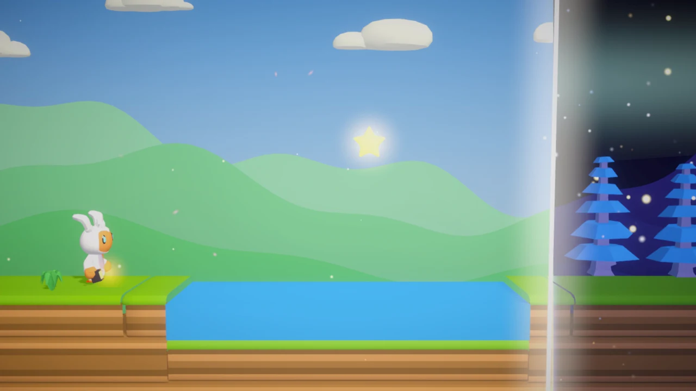

<div align="center">


**Mueve la línea. Cambia el mundo.** · *Shift the line. Change the world.*

[](https://0scar07.itch.io/game-off-2026)
[](https://itch.io/jam/game-off-2026)
[](https://unity.com)
[](https://github.com/0scar07/game-off-2026/actions/workflows/niveles.yml)
[](https://github.com/0scar07/game-off-2026/actions/workflows/itch-web.yml)
[](LICENSE)
[](https://github.com/0scar07/game-off-2026/releases)
[](https://github.com/0scar07/game-off-2026/releases)

Plataformas 2.5D para el **GitHub Game Off 2026**. Navegador, ordenador y móvil.
Español, inglés, portugués y francés.



<sub>[GIF en máxima calidad](docs/fase-maxima-calidad.gif) · [GIF ligero](docs/fase.gif)</sub>

[Descargar](#descargar) · [Español](#español) · [English](#english) · [Niveles](#niveles) · [Probar el juego](#probar-el-juego-y-dar-tu-opinión) · [Cómo está hecho](#cómo-está-hecho) · [Créditos](#créditos) · [Licencia](#licencia)

</div>

---

## Descargar

| Plataforma | Paquete | Descarga |
|---|---|---|
| 🌐 Navegador | Jugar sin instalar (ordenador y móvil) | [**Jugar en itch.io**](https://0scar07.itch.io/game-off-2026) |
| 🪟 Windows | Portable (descomprimir y jugar) | [FASE-Windows-Portable-x86_64.zip](https://github.com/0scar07/game-off-2026/releases/latest/download/FASE-Windows-Portable-x86_64.zip) |
| 🤖 Android | APK (instalar a mano) | [FASE-Android.apk](https://github.com/0scar07/game-off-2026/releases/latest/download/FASE-Android.apk) |
| 🪟 Windows | Instalador | *próximamente* |
| 🐧 Linux | AppImage | *próximamente* |

Todas las versiones están en [Releases](https://github.com/0scar07/game-off-2026/releases).
En Android hay que permitir "instalar apps de origen desconocido" para el APK.

---

## Español

Una línea parte el mundo en dos. A un lado es de **día**: puentes de madera, flores que te lanzan
al cielo, relojes de sol que se mueven. Al otro es de **noche**: hielo, luciérnagas y Sombras que
despiertan en la oscuridad. Eres **Lumi** y puedes **mover la línea**: un puente solo existe
mientras le da el sol, un lago helado solo te sostiene mientras hay luna.

| | | |
|---|---|---|
|  |  |  |
|  |  |  |

### Qué tiene

**La historia**
- **19 niveles** en 3 capítulos, con **3 jefes** que se enfadan por fases y **3 niveles secretos**.
- **Chispa**, una lucecita que te acompaña en cinco niveles y te pide que busques su estrella.
- Al terminar el bosque **eliges a quién ayudar**, al día o a la noche, y el final lo recuerda.
- **Diario de Lumi**, páginas de cuento entre capítulos, **dos finales** y un **final secreto**
  (con toda la luna y todo el diario).
- El mapa del viaje se recorre con Lumi andando de nivel en nivel.

**La línea y el mundo**
- La línea puede ser vertical, **inclinada**, **tumbada**, **doble** o **curva**, y en algunos niveles **pesa**
  o **te persigue**. El farol abre una **burbuja de noche**.
- Relojes de sol, corrientes de aire, caminos de luciérnagas, cajas de madera o hielo, brotes que
  crecen al sol, espejos, llaves de día y de noche, mareas, viento, plataformas al ritmo de la
  música y sombras que se pisan.
- Junto a la línea siempre atardece: luz dorada y sombras largas.
- **18 niveles extra** con mecánicas nuevas, entre ellos la **Ciudad de la Aurora** y el **Fondo del Mar**.

**Modos y retos**
- **Medallas** de tiempo (Bronce, Plata, Oro y Luna), medallas de estilo, **29 logros** y retos de la semana.
- **Retos:** contrarreloj de cada capítulo con tiempos por tramos, condiciones ("sin caer ni una
  vez"...) y mutadores al terminar la historia (gravedad baja, Lumi gigante, a oscuras...).
- **Con amigos:** carrera a dos en el mismo ordenador y **fantasma de un amigo** con un código.
- **Habilidades** que se ganan jugando: doble salto, planear con el farol y burbuja más grande.
- **Taller de niveles** con códigos y enlaces para compartir, **modo sin fin** que se adapta a tu
  ritmo, **desafío diario**, **cooperativo local** (uno mueve a Lumi y otro la línea) y **Nox**, la Lumi de la noche.
- Tienda de cosméticos, galería, álbum de fotos, banda sonora y **modo foto**.

**Para todo el mundo**
- Modo relajado, juego más lento, modo de un solo toque, pistas de la línea, alto contraste,
  teclas configurables, texto más grande, brillo y vibración.
- Música, efectos y voz propios que cambian entre el día y la noche.

### Controles

| Acción | Teclado | Ratón / táctil | Mando |
|---|---|---|---|
| Moverse | A / D o ← → | botones en pantalla | stick izquierdo |
| Saltar (y doble salto) | Espacio / W / ↑ | botón en pantalla | A / ✕ |
| Planear con el farol | mantener saltar al caer | mantener el botón | mantener A / ✕ |
| Mover la línea | Q / E o Shift | arrastrar la línea | stick derecho o LB / RB |
| Burbuja de noche | L | botón del farol | Y / △ |
| Soltar la caja | ↓ / S | — | cruceta abajo |
| Pausa · volver al punto de control · foto | Esc · mantener R · F | botón de pausa | Start · mantener Select |
| Jugador 2 en la carrera | ← → y ↑ o Ctrl derecho | — | segundo mando |

El doble salto y el planeo hay que ganarlos primero (Extras → Habilidades).

---

## English

A line splits the world in two. On one side it's **day**: wooden bridges, flowers that launch
you skyward, sundials that move. On the other it's **night**: ice, fireflies and Shadows that wake
in the dark. You are **Lumi**, and you can **shift the line**. A bridge only exists while the sun
shines on it. A frozen lake only holds you while the moon is up.

- **19 story levels** across 3 chapters, **3 bosses** with phases, secret levels and a **secret ending**.
- **Spark**, a companion who asks for help. **A story choice** that changes the ending.
- **18 extra levels** with new mechanics: curved, heavy or chasing lines, mirrors, keys, tides,
  wind, rhythm platforms, the **Aurora City** and the **Sea Floor**.
- **Challenges:** chapter time trials with splits, conditions and mutators.
- **Two-player race**, a **friend's ghost** shared by code, and **skills** to unlock (double jump, glide, bigger bubble).
- Time and style medals, 29 achievements, a **level workshop** with shareable codes and links,
  an adaptive **endless mode**, a **daily challenge**, **local co-op** and photo mode.
- Accessibility options, original music, sound and voice. Spanish, English, Portuguese and French.

**Controls:** A/D or arrows to move · Space/W/↑ to jump · hold jump while falling to glide · Q/E or
Shift to move the line (or drag it) · L for the night bubble · Esc to pause · hold R to go back to
the checkpoint · F for photo mode. Player 2 in the race: arrows and ↑ or right Ctrl.

---

## Niveles

| # | Capítulo I · La Pradera | # | Capítulo II · El Bosque Otoñal | # | Capítulo III · La Cumbre Helada |
|---|---|---|---|---|---|
| 1 | Amanecer | 7 | Criaturas | 13 | La torre |
| 2 | Noche estrellada | 8 | Alas en la noche | 14 | Río nocturno |
| 3 | Las dos mitades | 9 | Al revés | 15 | Dos líneas |
| 4 | Lago helado | 10 | Sierras del bosque | 16 | La subida *(línea tumbada)* |
| 5 | Relojes de sol | 11 | Luciérnagas | 17 | Eclipse |
| 6 | **Garra del Alba** *(jefe)* | 12 | **Reina de Escarcha** *(jefe)* | 18 | Cuesta de la luna *(línea inclinada)* |
| ★ | *Jardín del viento* (secreto) | ★ | *Bosque oscuro* (secreto) | 19 | **La Gran Sombra** *(jefe final)* |
| | | | | ★ | *Aurora* (secreto) |

**Niveles extra** (Extras → Niveles extra): Trucos de la línea, Atardecer, Espejos, La línea pesa,
La noche te sigue, Marea y viento, Llaves, A oscuras, Ritmo, Línea curva, Sombras y estaciones,
Escalada, Ciudad de la aurora, Tejados, La avenida, El arrecife, Corrientes y Marea profunda.

**Niveles de la comunidad:** crea uno en el Taller del juego, pulsa *Copiar código* y
compártelo con la plantilla [Nivel de la comunidad](https://github.com/0scar07/game-off-2026/issues/new?template=nivel.yml).
Los mejores entrarán en el juego.

Cada nivel es un archivo de texto en [`Assets/Levels`](Assets/Levels) (el formato está en el
[LEEME](Assets/Levels/LEEME.md)), y [`comprobar_niveles.py`](Tools/comprobar_niveles.py)
verifica en cada cambio que todos se pueden terminar.

---

## Probar el juego y dar tu opinión

¿Lo has jugado? Cuéntanos qué tal con la plantilla
[Prueba del juego](https://github.com/0scar07/game-off-2026/issues/new?template=prueba.yml):
dónde te atascaste, qué te gustó y qué quitarías. Los fallos van en
[Fallo](https://github.com/0scar07/game-off-2026/issues/new?template=fallo.yml) y las ideas en
[Idea](https://github.com/0scar07/game-off-2026/issues/new?template=idea.yml).

---

## Cómo está hecho

- **Motor:** Unity 6.6 (URP) y C#. Exporta a la web (WebGL), Windows y Android.
- **Niveles en texto.** **Fase → Generar niveles** convierte cada `.txt` en una escena con arte,
  colisiones, luces, música e interfaz ([`Assets/Editor`](Assets/Editor)). Los genera
  [`niveles.py`](Tools/niveles.py) a partir de tramos (puentes, lagos, espejos, llaves...).
- **Shaders propios** ([`Assets/Shaders`](Assets/Shaders)): recortan cada objeto por la línea
  proyectada en pantalla, para cualquier ángulo, dos líneas, la línea curva, la burbuja del farol
  y las zonas de día o de noche.
- **Herramientas en Python** ([`Tools`](Tools)): niveles, música, efectos, voz, fuente y tráiler.
- **Pruebas automáticas:** en cada cambio se comprueba que todos los niveles se pueden terminar;
  antes de subir a itch, la versión web se abre en Chrome y se juega un poco sin errores
  ([`Tools/prueba_web`](Tools/prueba_web)).
- **Tráiler:** un director de cámara dentro del juego graba cada plano fotograma a fotograma
  ([`TrailerDirector.cs`](Assets/Scripts/TrailerDirector.cs)) y `montar_trailer.py` lo monta.

### Documentos

| Documento | Qué tiene |
|---|---|
| [`docs/DISENO.md`](docs/DISENO.md) | El diseño completo del juego |
| [`docs/PENDIENTES.md`](docs/PENDIENTES.md) | Todas las ideas, de la más pequeña a la más grande |
| [`docs/TANDAS.md`](docs/TANDAS.md) | Cómo se programaron las ideas, por tandas, y cuáles no se pueden hacer |
| [`docs/RECORTES.md`](docs/RECORTES.md) | Qué se queda fuera si no da tiempo, semana a semana |
| [`docs/maquetas`](docs/maquetas) | Las maquetas de cada idea antes de programarla |
| [`docs/prensa`](docs/prensa/README.md) | Kit de prensa: logo, capturas y descripciones |
| [`CHANGELOG.md`](CHANGELOG.md) | Los cambios de cada versión |

### Abrir el proyecto

1. Instala **Unity 6000.6.7f1** desde Unity Hub (con *WebGL Build Support*).
2. Abre esta carpeta como proyecto.
3. **Fase → Generar niveles** y pulsa *Play* en la escena `Menu`.
4. **Fase → Exportar web** deja la versión de navegador en `Builds/Web`.
5. Para publicarla en itch, crea una release con la etiqueta `web-AAAAMMDD-N`: se prueba sola y se sube.

### Estructura

```
Assets/
  Levels/        niveles en texto (+ Diarios/ con los desafíos diarios)
  Scripts/       el juego: línea, Lumi, mecánicas, jefes, menús, retos, logros, taller, sin fin...
  Editor/        generador de niveles, biomas, piezas y exportaciones
  Shaders/       recorte por la línea y partículas
  Resources/     catálogo de niveles, vistas previas y sonidos de la interfaz
  Art/ Audio/    modelos, fuentes, música, efectos y voz
Tools/           scripts de Python (ver Tools/README.md) y la prueba de la versión web
Trailer/         títulos, música y guion de planos del tráiler
docs/            diseño, ideas, maquetas y capturas
.github/         pruebas automáticas, subida a itch y plantillas de issues
```

---

## Créditos

- Diseño, niveles y programación: **[0scar07](https://github.com/0scar07)**
- Modelos 3D: **[Quaternius](https://quaternius.com)** y **[Kenney](https://kenney.nl)** (CC0)
- Fuente: **Fredoka** (SIL Open Font License), con símbolos añadidos para el juego (*Fredoka Fase*)
- Música, efectos y voz: generados para este juego (Python y voces del sistema)
- Hecho con ayuda de IA (Claude, de Anthropic) para el código, las herramientas y los textos;
  las ideas, el diseño y las pruebas son del autor.

Hecho para el [GitHub Game Off 2026](https://itch.io/jam/game-off-2026).

## Licencia

- **Código** (scripts, shaders, herramientas): [MIT](LICENSE).
- **Modelos** de Quaternius y Kenney: CC0 (dominio público).
- **Fuente** Fredoka y su versión *Fredoka Fase*: [SIL Open Font License 1.1](Assets/Art/Fonts/OFL-Fredoka.txt).
- **Música, efectos, voz, ilustraciones y niveles** hechos para FASE: © 2026 0scar07.
