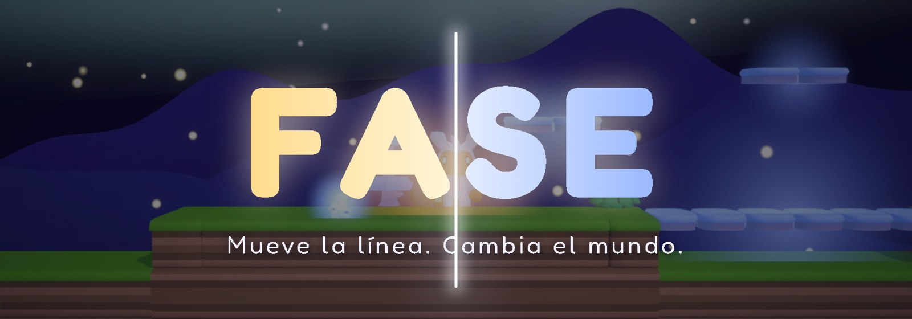
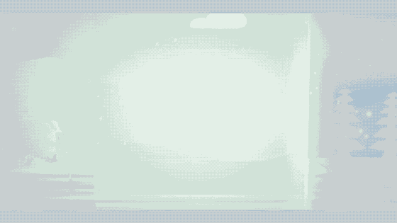
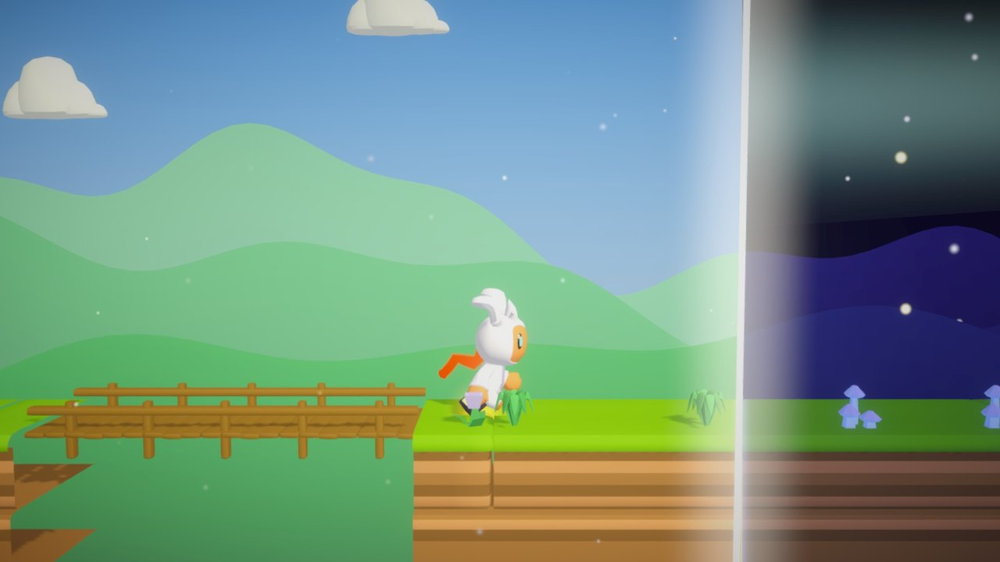
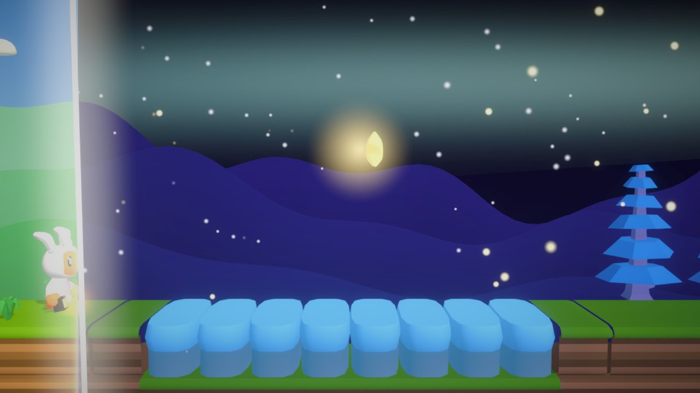
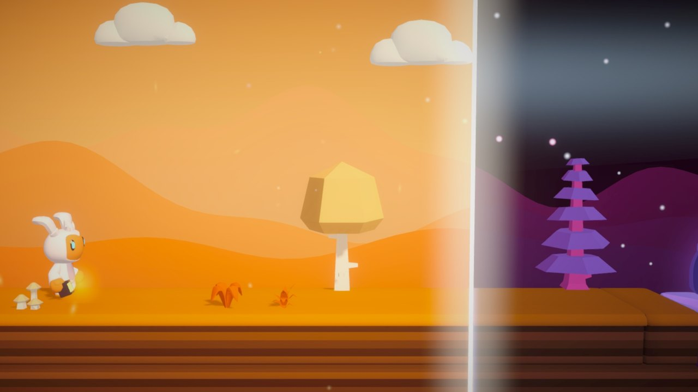
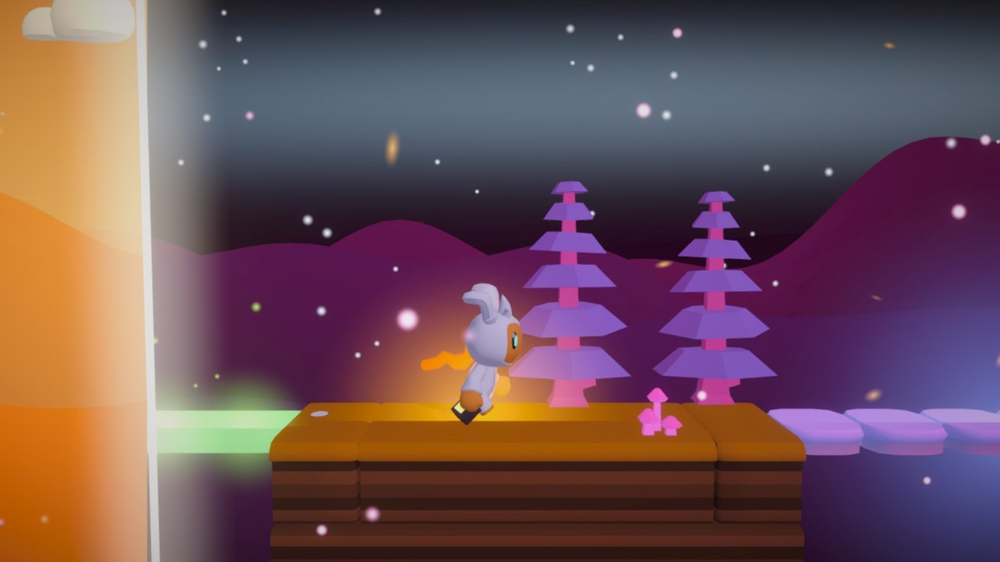
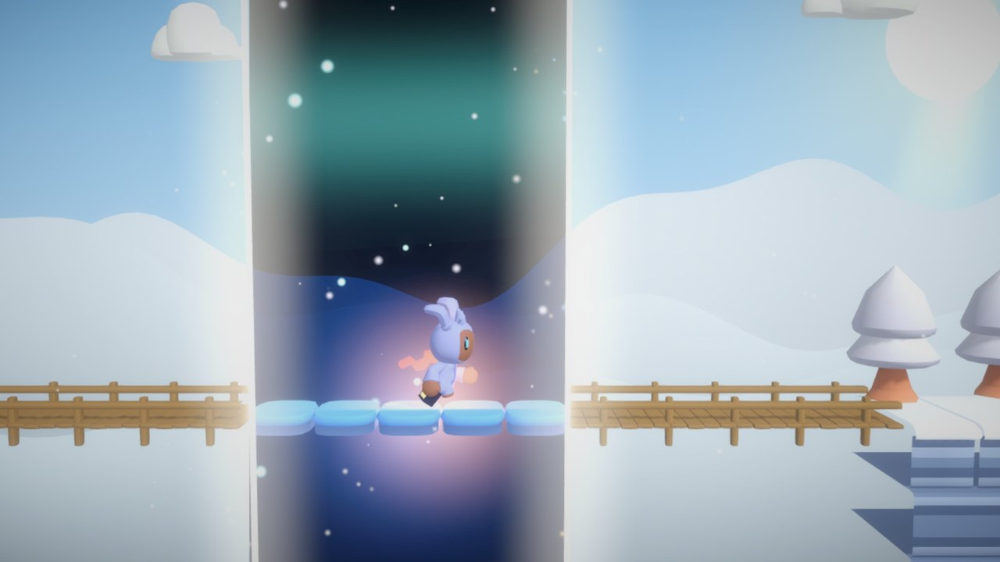
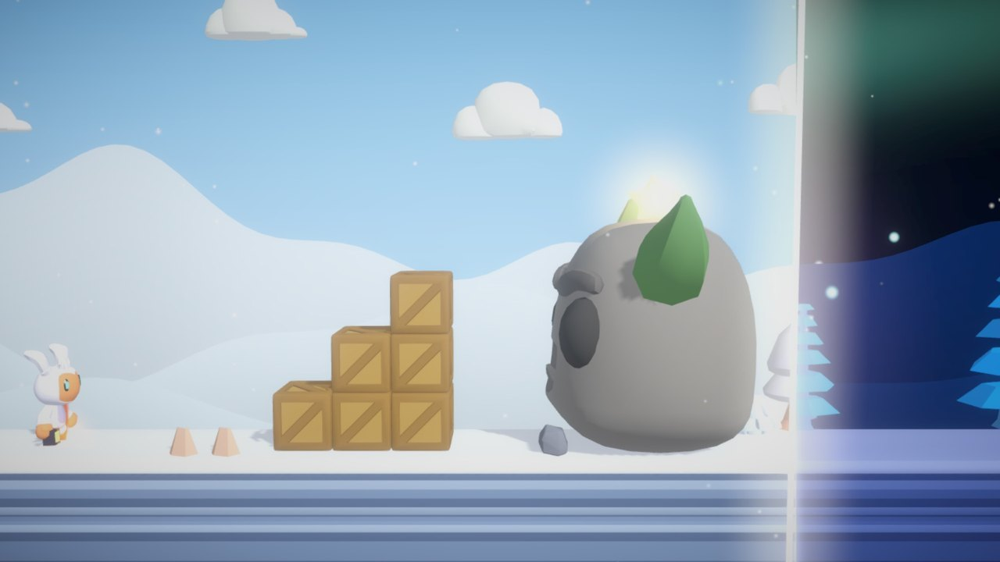

<div align="center">



**Mueve la línea. Cambia el mundo.** · *Shift the line. Change the world.*

[](https://0scar07.itch.io/game-off-2026)
[](https://itch.io/jam/game-off-2026)
[](https://unity.com)
[](https://github.com/0scar07/game-off-2026/actions/workflows/niveles.yml)
[](LICENSE)

Plataformas 2.5D para el **GitHub Game Off 2026**. Navegador, ordenador y móvil. Español e inglés.



[Español](#español) · [English](#english) · [Niveles](#niveles) · [Cómo está hecho](#cómo-está-hecho) · [Créditos](#créditos) · [Licencia](#licencia)

</div>

---

## Español

Una línea parte el mundo en dos. A un lado es de **día**: puentes de madera, flores que te lanzan
al cielo, relojes de sol que se mueven. Al otro es de **noche**: hielo, luciérnagas y Sombras que
despiertan en la oscuridad. Eres **Lumi** y puedes **mover la línea**: un puente solo existe
mientras le da el sol, un lago helado solo te sostiene mientras hay luna.

| | | |
|---|---|---|
|  |  |  |
|  |  |  |

### Qué tiene

- **19 niveles** en 3 capítulos, **3 jefes** y **3 niveles secretos**.
- La línea puede ser vertical, **inclinada**, **tumbada** o **doble**; el farol abre una **burbuja de noche**.
- Relojes de sol, corrientes de aire, caminos de luciérnagas, cajas que cambian de madera a hielo, energía de la línea.
- **Medallas** de tiempo (Bronce, Plata, Oro y Luna), **22 logros**, desafíos por nivel, fantasma de tu récord y repeticiones.
- **Diario de Lumi**, **dos finales**, **cooperativo local** (uno mueve a Lumi y otro la línea) y **Nox**, la Lumi de la noche.
- **Taller de niveles** con códigos para compartir, **modo sin fin**, **desafío diario**, tienda de cosméticos y **modo foto**.
- Accesibilidad: modo asistido, alto contraste, teclas configurables, velocidad de la línea, vibración.
- Música, efectos y voz propios que cambian entre el día y la noche.

### Controles

| Acción | Teclado | Ratón / táctil | Mando |
|---|---|---|---|
| Moverse | A / D o ← → | botones en pantalla | stick izquierdo |
| Saltar | Espacio / W / ↑ | botón en pantalla | A / ✕ |
| Mover la línea | Q / E o Shift | arrastrar la línea | — |
| Burbuja de noche | L | botón del farol | Y / △ |
| Pausa · reintentar · foto | Esc · R · F | botón de pausa | Start |

---

## English

A line splits the world in two. On one side it's **day**: wooden bridges, flowers that launch
you skyward, sundials that move. On the other it's **night**: ice, fireflies and Shadows that wake
in the dark. You are **Lumi**, and you can **shift the line**. A bridge only exists while the sun
shines on it. A frozen lake only holds you while the moon is up.

**19 levels** across 3 chapters, **3 bosses**, secret levels, time medals, 22 achievements, a
**level workshop** with shareable codes, an **endless mode**, a **daily challenge**, **local co-op**,
**two endings**, photo mode and accessibility options. Original music, sound and voice.

**Controls:** A/D or arrows to move · Space/W/↑ to jump · Q/E or Shift to move the line (or drag
it) · L for the night bubble · Esc to pause · R to retry · F for photo mode.

---

## Niveles

| # | Capítulo I · La Pradera | # | Capítulo II · El Bosque Otoñal | # | Capítulo III · La Cumbre Helada |
|---|---|---|---|---|---|
| 1 | Amanecer | 7 | Criaturas | 13 | La torre |
| 2 | Noche estrellada | 8 | Alas en la noche | 14 | Río nocturno |
| 3 | Las dos mitades | 9 | Al revés | 15 | Dos líneas |
| 4 | Lago helado | 10 | Sierras del bosque | 16 | La subida *(línea tumbada)* |
| 5 | Relojes de sol | 11 | Luciérnagas | 17 | Eclipse |
| 6 | **Garra del Alba** *(jefe)* | 12 | **Reina de Escarcha** *(jefe)* | 18 | Cuesta de la luna *(línea inclinada)* |
| ★ | *Jardín del viento* (secreto) | ★ | *Bosque oscuro* (secreto) | 19 | **La Gran Sombra** *(jefe final)* |
| | | | | ★ | *Aurora* (secreto) |

Cada nivel es un archivo de texto en [`Assets/Levels`](Assets/Levels) (el formato está en el
[LEEME](Assets/Levels/LEEME.md)), y [`comprobar_niveles.py`](Tools/comprobar_niveles.py)
verifica en cada cambio que todos se pueden terminar.

---

## Cómo está hecho

- **Motor:** Unity 6.6 (URP) y C#. Exporta a la web (WebGL) y a Windows.
- **Niveles en texto.** **Fase → Generar niveles** convierte cada `.txt` en una escena con arte,
  colisiones, luces, música e interfaz ([`Assets/Editor`](Assets/Editor)).
- **Shaders propios** ([`Assets/Shaders`](Assets/Shaders)): recortan cada objeto por la línea
  proyectada en pantalla, para cualquier ángulo, dos líneas o la burbuja del farol.
- **Herramientas en Python** ([`Tools`](Tools)): niveles, música, efectos, voz, fuente y tráiler.
- **Tráiler:** un director de cámara dentro del juego graba cada plano fotograma a fotograma
  ([`TrailerDirector.cs`](Assets/Scripts/TrailerDirector.cs)) y `montar_trailer.py` lo monta.
- **Diseño:** el documento completo está en [`docs/DISENO.md`](docs/DISENO.md); los cambios, en
  el [`CHANGELOG`](CHANGELOG.md).

### Abrir el proyecto

1. Instala **Unity 6000.6.7f1** desde Unity Hub (con *WebGL Build Support*).
2. Abre esta carpeta como proyecto.
3. **Fase → Generar niveles** y pulsa *Play* en la escena `Menu`.
4. **Fase → Exportar web** deja la versión de navegador en `Builds/Web`.

### Estructura

```
Assets/
  Levels/        niveles en texto (+ Diarios/ con los desafíos diarios)
  Scripts/       el juego: línea, Lumi, jefes, menús, logros, taller, sin fin...
  Editor/        generador de niveles, piezas y exportaciones
  Shaders/       recorte por la línea y partículas
  Art/ Audio/    modelos, fuentes, música, efectos y voz
Tools/           scripts de Python (ver Tools/README.md)
Trailer/         títulos, música y guion de planos del tráiler
docs/            diseño y capturas
```

---

## Créditos

- Diseño, niveles y programación: **[0scar07](https://github.com/0scar07)**
- Modelos 3D: **[Quaternius](https://quaternius.com)** y **[Kenney](https://kenney.nl)** (CC0)
- Fuente: **Fredoka** (SIL Open Font License), con símbolos añadidos para el juego (*Fredoka Fase*)
- Música, efectos y voz: generados para este juego (Python y voces del sistema)
- Hecho con ayuda de IA (Claude, de Anthropic) para el código, las herramientas y los textos;
  las ideas, el diseño y las pruebas son del autor.

Hecho para el [GitHub Game Off 2026](https://itch.io/jam/game-off-2026).

## Licencia

- **Código** (scripts, shaders, herramientas): [MIT](LICENSE).
- **Modelos** de Quaternius y Kenney: CC0 (dominio público).
- **Fuente** Fredoka y su versión *Fredoka Fase*: [SIL Open Font License 1.1](Assets/Art/Fonts/OFL-Fredoka.txt).
- **Música, efectos, voz, ilustraciones y niveles** hechos para FASE: © 2026 0scar07.
