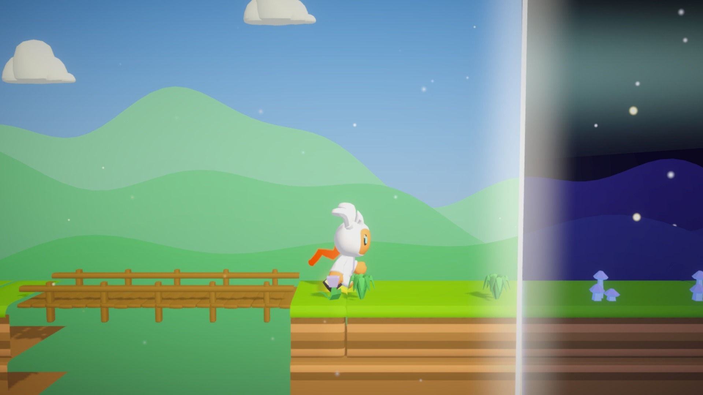
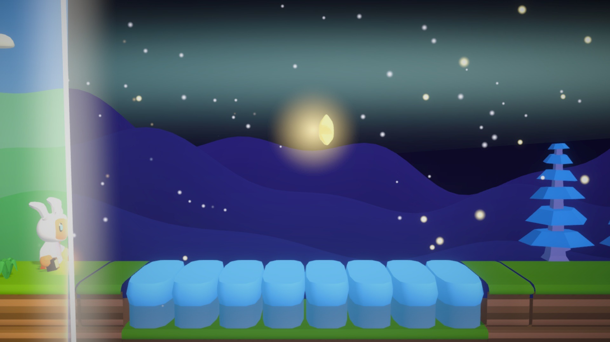
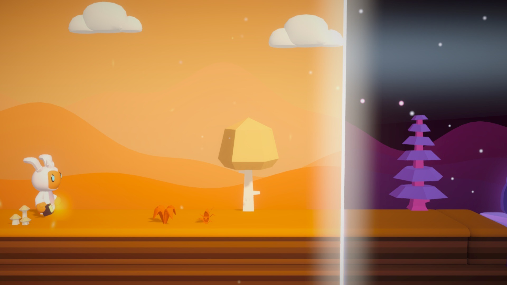
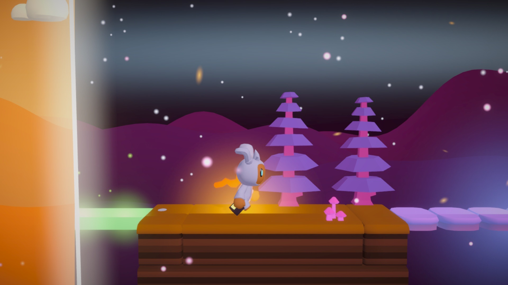
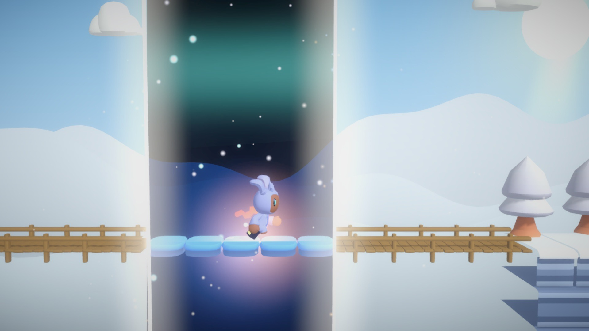
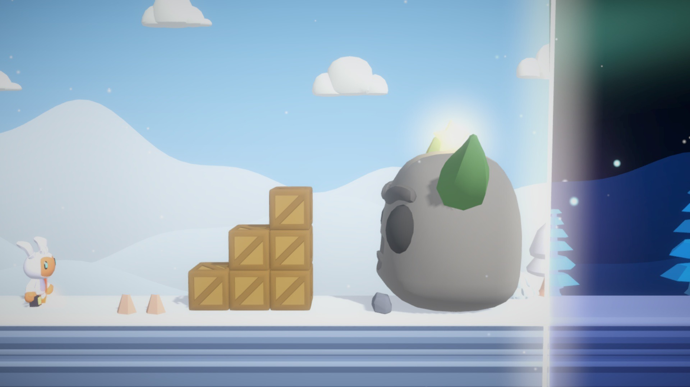

# Kit de prensa · Press kit

Todo lo necesario para escribir sobre **FASE**. Se puede usar libremente para hablar del juego.
*Everything you need to write about FASE. Free to use when covering the game.*

## Datos · Facts

| | |
|---|---|
| **Título** | FASE |
| **Autor** | 0scar07 ([GitHub](https://github.com/0scar07)) |
| **Género** | Plataformas 2.5D de puzle |
| **Plataformas** | Navegador (ordenador y móvil), Windows, Android |
| **Idiomas** | Español, inglés |
| **Precio** | Gratis |
| **Hecho para** | [GitHub Game Off 2026](https://itch.io/jam/game-off-2026), tema **SHIFT** |
| **Jugar** | [0scar07.itch.io/game-off-2026](https://0scar07.itch.io/game-off-2026) |
| **Código** | [github.com/0scar07/game-off-2026](https://github.com/0scar07/game-off-2026) |

## Descripción corta · Short description

**ES:** Una línea parte el mundo en día y noche. Muévela para que los puentes de madera existan
al sol y el hielo bajo la luna, y lleva a Lumi a reunir los fragmentos de la luna rota.

**EN:** A line splits the world into day and night. Shift it so wooden bridges exist in the sun
and ice under the moon, and help Lumi gather the pieces of the broken moon.

## Descripción larga · Long description

**ES:** En FASE una línea vertical parte el mundo: a un lado es de día y al otro de noche, y cada
cosa solo existe en su mundo. Los puentes de madera, las flores que impulsan y los relojes de sol
viven al sol; el hielo, las luciérnagas y las Sombras despiertan en la oscuridad. Moviendo la
línea, Lumi decide qué es real en cada paso. Tiene 19 niveles en 3 capítulos, 3 jefes, niveles
secretos, medallas de tiempo, un taller de niveles con códigos para compartir, modo sin fin,
desafío diario, cooperativo local y dos finales, con música y sonido propios que cambian entre
el día y la noche.

**EN:** In FASE a vertical line splits the world: day on one side, night on the other, and
everything exists in only one of them. Wooden bridges, springy flowers and sundials live in the
sun; ice, fireflies and Shadows wake in the dark. By shifting the line, Lumi decides what is real
at every step. 19 levels across 3 chapters, 3 bosses, secret levels, time medals, a level
workshop with shareable codes, an endless mode, a daily challenge, local co-op and two endings,
with original music and sound that shift between day and night.

## Material · Assets

- **Logo** (fondo transparente): [`logo-es.png`](logo-es.png) · [`logo-en.png`](logo-en.png)
- **Imagen para redes** 1280×640: [`redes-1280x640.jpg`](redes-1280x640.jpg)
- **Banner**: [`../banner.jpg`](../banner.jpg)
- **Capturas** 1920×1080: [`captura-1.jpg`](captura-1.jpg) … [`captura-8.jpg`](captura-8.jpg)
- **Animación**: [`../fase.webp`](../fase.webp) · [GIF](../fase-maxima-calidad.gif)
- **Tráiler** (50 s, ES y EN): en la [última versión](https://github.com/0scar07/game-off-2026/releases)

| | | |
|---|---|---|
|  |  |  |
|  |  |  |
